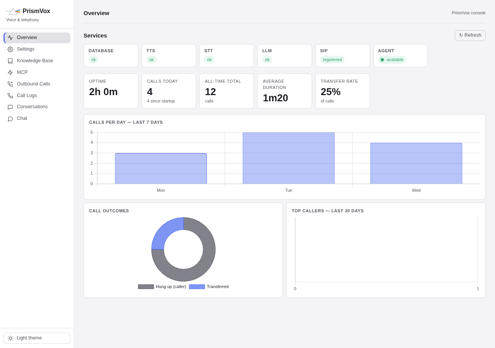
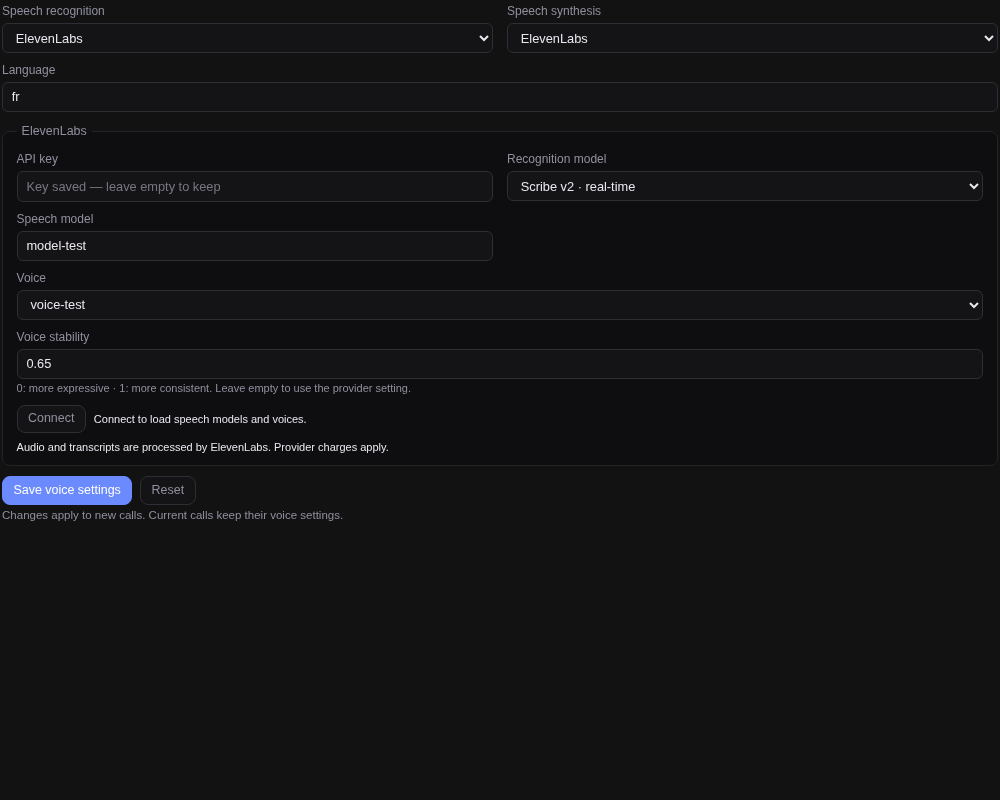
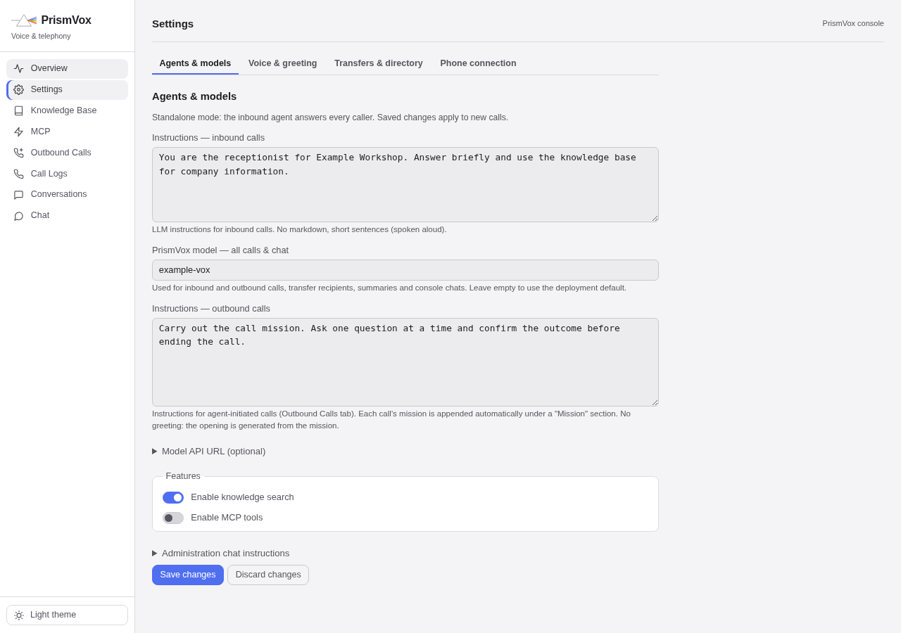

<div align="center">
  <br>
  <h1>PrismVox</h1>
  <p><em>An open-source AI phone receptionist for your SIP trunk or PBX.</em></p>
</div>

**[Documentation](https://www.thelastserver.com/docs/prismvox/installation/)**

PrismVox answers calls, retrieves information from your knowledge base, transfers
callers, records messages and makes outbound calls with a supplied mission. It
runs independently or connects to [Prism](https://github.com/blazux/prism), with
caller identification and access to the caller's permitted knowledge.

**MIT licensed.** Bring your own language model. ElevenLabs handles speech by
default; compatible self-hosted speech APIs are optional. No STT or TTS engine
is bundled or deployed.



## Features

- SIP telephony through Asterisk, including TLS/SRTP and UDP trunks.
- Streaming speech recognition and synthesis with ElevenLabs.
- Voice activity detection and caller interruption during playback.
- Blind and attended transfers, messages and an outbound call queue.
- Agent-controlled knowledge searches with PostgreSQL and pgvector.
- MCP tools over Streamable HTTP or legacy SSE.
- Separate model and API URLs for incoming calls and outbound missions.
- Call history, transcripts, conversation supervision and a dark/light console.
- Optional Prism integration: recognized callers use Prism's voice agent;
  unknown callers stay with the switchboard.

## Requirements

- Docker and Docker Compose.
- A SIP trunk or PBX reachable from the deployment, including its media path.
- An OpenAI-compatible language model API with streaming and tool calling.
- An ElevenLabs account with Speech to Text and Text to Speech permissions.
  Models Read and Voices Read allow the console to load its catalogues.
- No GPU is required when your model and speech providers run elsewhere.

## Quick start

See the [installation guide](https://www.thelastserver.com/docs/prismvox/installation/)
for detailed setup instructions and links to SIP, speech-provider and console configuration.

```sh
git clone https://github.com/blazux/PrismVox.git
cd PrismVox
cp .env.example .env
```

Edit `.env`:

1. Replace `ARI_PASS`, `DB_PASS` and `UI_PASSWORD` with distinct strong passwords
   (`openssl rand -hex 24` generates one).
2. Set your `SIP_*` trunk values and `OPENAI_BASE_URL` / `OPENAI_MODEL`.
3. Set `AGENT_API_KEY` if you use the text agent or OpenAI-compatible API.

```sh
docker compose up -d --build
```

Open **http://localhost:7860** and sign in using `UI_USER` / `UI_PASSWORD`.
The HTTPS console at **https://localhost:7861** uses a self-signed certificate.
Both ports bind to localhost by default. For remote use, put the console behind
a trusted HTTPS reverse proxy; `UI_BIND` controls the published bind address.
Browser microphone access requires HTTPS or localhost.

The stack starts Asterisk, the Go call agent, the console, PostgreSQL/pgvector
and a knowledge-embedding service. The embedding model downloads on first startup;
it is separate from STT/TTS. Persistent data lives in Docker volumes.

### Configure ElevenLabs



In **Configuration → Speech providers**:

1. Select **ElevenLabs** for recognition and synthesis.
2. Enter your API key and click **Connect**.
3. Choose a voice and a speech model, then **Save voice settings**.
4. Use the voice preview in Configuration to hear the selected voice.

Defaults are `scribe_v2_realtime` for recognition and `eleven_flash_v2_5` for
synthesis, with French as the language. Change the language, agent persona,
greeting and fixed phrases together for other callers.

**Connect** loads the available models and voices; **Save** persists the settings.
If Models Read is unavailable, your selected model is retained and the console
explains how to enable the full catalogue. A blank API key input preserves the
saved key. Changes apply to new calls, not calls already in progress.

**Voice stability** accepts 0–1: lower values allow more vocal variation, higher
values favour consistency. Leave it empty to use the voice's provider setting.
Short replies are synthesized together where possible; streaming waits at most
200 ms after the first complete sentence to group up to 400 characters. Longer
or slower replies start progressively. Completed audio requests are linked within
each call where the provider supports request stitching.

Audio, text sent for synthesis and transcripts are processed by ElevenLabs.
Provider charges apply. Language-model requests go to the model provider you
configure. The API key is encrypted in PostgreSQL and never returned by read APIs.

### Connect your own STT/TTS services

In **Speech providers**, select **Self-hosted · OpenAI-compatible API** independently
for recognition and synthesis. Set the API root, including `/v1`, and the model
ID. For synthesis, also enter a voice ID if your service requires one. An optional
service Bearer key can authenticate these external APIs; it is stored encrypted
and is separate from your ElevenLabs credential.

PrismVox uses these contracts, without depending on a particular model or engine:

| Operation | Request | Response |
| --- | --- | --- |
| Recognition | `POST /v1/audio/transcriptions`, multipart `file`, optional `model`, `language`, `prompt`, `response_format=json` | JSON with `text` |
| Synthesis | `POST /v1/audio/speech`, JSON `input`, `model`, optional `voice`, `response_format=wav` | Mono WAV audio, resampled for telephony |

You can mix providers, for example external recognition with ElevenLabs synthesis.
Deploy and maintain the speech servers separately. Their URLs must be reachable
from the Docker network: `localhost` inside a container is that container, not
your host. On Linux, `host.docker.internal` maps to the host gateway; the service
must listen on an address reachable from that network.

There is no automatic adapter for arbitrary proprietary APIs. **Legacy HTTP
service** preserves the older contract: recognition posts a multipart `audio`
file to `/transcribe`; synthesis posts JSON `text` to the configured `/synthesize`
URL. Optional `hotwords`, `spell_words` and `spell_exceptions` retain compatibility
with existing servers. Legacy voice management routes depend on that server.
For OpenAI-compatible services, manage voice uploads/deletion on the speech server.

## Configure the receptionist



| Console page | What you configure or inspect |
| --- | --- |
| Overview | SIP status, active calls and aggregate call activity |
| Configuration → Agent | Persona, greeting, knowledge/MCP switches and model URLs |
| Configuration → Speech providers | STT, TTS, voices, language and provider credentials |
| Configuration → SIP | Trunk, TLS/UDP transport and transfer method |
| Configuration → Phrases / Dictionary | Spoken prompts, names and acronym pronunciation |
| Knowledge | Collections and reference documents available for retrieval |
| MCP | Tool servers, connection details and exposed tools |
| Directory | Contacts and blind/attended transfer preferences |
| Outbound calls | Missions, scheduling, attempts and outcomes |
| Call logs / Conversations | Call history, transcripts and tool activity |

A compatible model must support structured tool calls: saying “I will transfer
you” alone cannot transfer a call. The receptionist must call the transfer,
message or hang-up tool. Keep the persona concise and give it a knowledge base
for company-specific facts. Start with a few test calls before connecting a
production number.

Incoming switchboard calls use the **standard** model. Outbound missions,
transfer-recipient conversations and operator chat use the **on-call** model.
Each can use a separate API URL; leaving it empty uses `OPENAI_BASE_URL`.
Gateway credentials are not forwarded to a different model endpoint.

## Optional Prism integration

Set `PRISM_URL` and `PRISM_TOKEN` in PrismVox, and configure Prism's `VOX_URL` /
`VOX_API_KEY`. Both services must be reachable on a shared Docker network; keep
the call agent on a single network for reliable RTP addressing. When using the
standard project name, that network is `prismvox_agentnet`.

- Prism supplies the transfer directory from its user profiles.
- Recognized callers use Prism's voice agent with their profile and scoped
  knowledge. Voice tools remain restricted; recognition does not grant shell,
  file, mail or calendar access.
- Unknown callers use PrismVox's switchboard persona and Prism's selected public
  voice knowledge collection. Configure that collection in Prism.
- Prism relays transfers, messages and hang-up requests to PrismVox/Asterisk.
- The standalone console points to Prism when docked; its protected administration
  API remains available to Prism.
- **Prism → Admin → Telephony → Conversation model** can select a dedicated phone
  model on versions supporting that setting, while keeping the web default.

`PRISM_PUBLIC_URL` sets the browser-facing Prism URL when `PRISM_URL` is internal.

## Configuration and persistent data

`.env.example` lists bootstrap variables. SIP, persona, phrases, dictionary,
model tiers and speech settings can subsequently be changed in the console.
Saved database values take precedence over their bootstrap values.

| Variables | Purpose |
| --- | --- |
| `COMPOSE_PROJECT_NAME`, `COMPOSE_FILE` | Deployment identity and optional model overlay |
| `ARI_USER`, `ARI_PASS` | Internal Asterisk API credentials |
| `DB_PASS` | PostgreSQL password |
| `UI_USER`, `UI_PASSWORD`, `UI_BIND`, `UI_TLS_SAN` | Console authentication and publication |
| `AGENT_API_KEY` | Bearer authentication for text-agent/API clients |
| `SIP_*` | Initial trunk configuration and TLS verification |
| `OPENAI_BASE_URL`, `OPENAI_MODEL`, `OPENAI_API_KEY` | Language-model gateway |
| `STT_PROVIDER`, `TTS_PROVIDER` | `elevenlabs`, `openai` or legacy `service` |
| `ELEVENLABS_*` | ElevenLabs credentials, voice, models, language and stability |
| `STT_URL`, `TTS_URL`, `STT_MODEL`, `TTS_MODEL`, `TTS_VOICE` | External speech APIs |
| `SPEECH_SERVICE_API_KEY` | Optional Bearer credential for external speech APIs |
| `PRISM_URL`, `PRISM_TOKEN`, `PRISM_PUBLIC_URL` | Optional Prism connection |
| `WHISPER_HOTWORDS`, `TTS_SPELL_*` | Dictionary bootstrap, independent of the speech engine |
| `EMBEDDING_MODEL`, `RAG_TOP_K`, `BARGEIN_MS` | Knowledge retrieval and interruption timing |
| `LOG_SENSITIVE_DATA`, `DEBUG` | Optional content and SIP diagnostics |

Keep `pgdata`, `secrets` and `asterisk_dynamic` together when moving a deployment.
Stored credentials use AES-256-GCM; the encryption key lives in the persistent
`secrets` volume, outside PostgreSQL. Losing it makes those credentials unreadable.
Console TLS certificates live in `ui_certs`; generated media uses `sounds`.
Do not run `docker compose down -v` to update an installation.

### Optional local language model

`docker-compose.llm-local.yml` adds a GPU-backed llama.cpp endpoint; this is a
language model, not a speech engine. Its default recipe uses Qwen3.5-9B Q8_0 in
non-thinking mode. Download the GGUF referenced in that file to
`.dev/models/qwen3.5-9b`, append the overlay to `COMPOSE_FILE`, then select
`http://fast-llm:8080/v1` / `qwen3.5-9b` in the model configuration.
Allow about 12 GB of free GPU memory. The diagnostic API binds to localhost on
port 18120. `FAST_LLM_MODEL_DIR`, `FAST_LLM_MODEL_FILE`, `FAST_LLM_MODEL_NAME` and
`FAST_LLM_PORT` override the recipe.

## Upgrading from PrismConnect / older PrismVox installations

Keep the existing `COMPOSE_PROJECT_NAME`, database, encryption-key volume and SIP
configuration. Update `COMPOSE_FILE` to `docker-compose.yml` (plus the optional
language-model overlay). The old `docker-compose.local.yml` and
`docker-compose.elevenlabs.yml` speech services have been removed.
`docker-compose.direct-voice.yml` remains a compatibility overlay.

Before updating, select direct ElevenLabs in Speech providers, or point the
external service configuration at your separately deployed STT/TTS APIs.
Do not remove old speech containers or volumes until you have verified calls
with the replacement configuration. New installations default to ElevenLabs;
explicit saved provider choices remain unchanged.

## Security

Use distinct strong credentials and a trusted HTTPS reverse proxy for remote
administration. An empty console password or agent API key leaves that surface
open; keep it on a trusted network only. Asterisk's ARI and PostgreSQL are not
published on host ports. Restrict SIP/media traffic to your carrier or PBX.
TLS trunk certificate verification is enabled for new installations; configure
your carrier's CA when needed. UDP does not encrypt SIP or media.

Routine logs omit conversation content. `LOG_SENSITIVE_DATA=true` and
`DEBUG=true` can expose transcripts or SIP details; disable them after debugging.
Functional transcripts and tool history remain in PostgreSQL. Protect and back up
the database, persistent encryption key and trunk configuration. AES encryption
does not protect against an administrator controlling the running host.

## Development checks

```sh
(cd agent && go test -race ./... && go vet ./...)
python -m unittest discover -s ui/tests -v
node ui/tests/voice-browser.cjs
node ui/tests/dom-regressions.cjs
```

Install the UI requirements plus `httpx` for Python tests, and Playwright/Chromium
or jsdom for browser/DOM tests. Set `VOX_TEST_DATABASE_URL` to a disposable
PostgreSQL/pgvector database for integration tests. The tests use isolated schemas
and synthetic APIs; they do not make telephone calls or paid model requests.

## License

[MIT](LICENSE) — Copyright © 2026 Vincent Blazutti.
